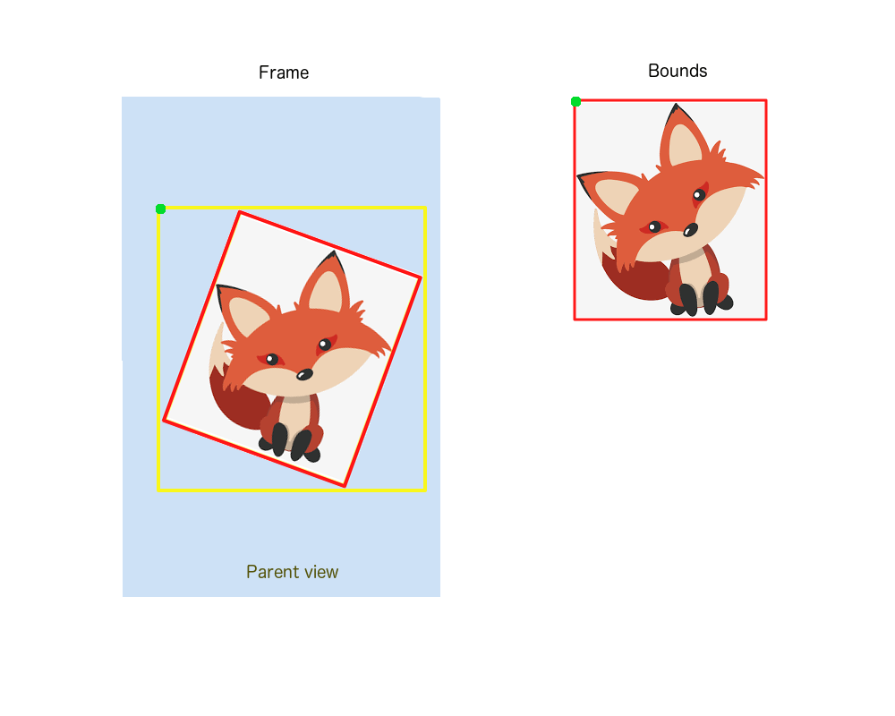

# Frame VS Bounds

* Frame: Là kích thước và vị trí của view trong hệ tọa độ cha của nó. Tức là, frame được đo bằng đơn vị pixel trong hệ tọa độ của superview (view cha). Ví dụ, nếu một view có frame (x: 10, y: 20, width: 100, height: 50) thì nó sẽ có vị trí x = 10, y = 20 so với góc trên bên trái của superview, và có kích thước 100x50.
* Bounds: Là kích thước và vị trí của view trong hệ tọa độ của chính nó. Tức là, bounds được đo bằng đơn vị pixel trong hệ tọa độ của view đó. Ví dụ, nếu một view có bounds (x: 0, y: 0, width: 100, height: 50) thì nó sẽ có vị trí x = 0, y = 0 so với góc trên bên trái của nó, và có kích thước 100x50.

<figure><figcaption></figcaption></figure>

```
Frame
   origin = (20, 52)
   width = 118
   height = 187
 
Bounds 
   origin = (0, 0)
   width = 80
   height = 130
```

Vì frame và bounds được đo bằng các hệ tọa độ khác nhau, nên chúng ta cần chú ý khi sử dụng chúng trong mã của mình. Ví dụ, nếu ta muốn lấy vị trí của một view trên màn hình, ta sử dụng thuộc tính frame. Tuy nhiên, nếu ta muốn tính toán kích thước thực tế của nội dung trong một view, ta nên sử dụng thuộc tính bounds.

Một số điểm khác biệt khác giữa frame và bounds:

* Thay đổi giá trị của frame sẽ ảnh hưởng đến vị trí và kích thước của view trong hệ tọa độ cha của nó, trong khi thay đổi giá trị của bounds chỉ ảnh hưởng đến vị trí và kích thước của nội dung trong view.
* Bounds thường được sử dụng để thực hiện các phép biến đổi hình học, ví dụ như xoay, thu phóng, hoặc dịch chuyển nội dung của view.
* Frame thường được sử dụng để xác định vị trí và kích thước của một view trong quá trình định vị.
